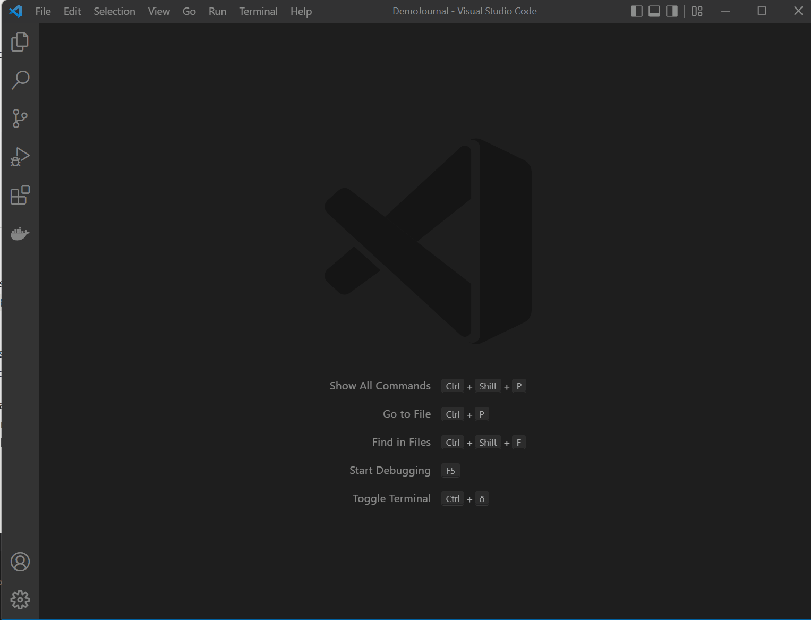

<table>
<tr>
<td>

</td>
<td>
<h1>
vscode-journal 
</h1>
Lightweight Extension for Visual Studio Code to take track of your daily notes. 
</td>
</tr>
</table>

 

## What's new in 1.2

**Your journal for AI assistants: the MCP server is included.** GitHub Copilot, Claude Code, Codex and other assistants can read and write your journal: the morning briefing, open tasks, memos, time entries and notes, by asking in plain language ("what's open today?", "move task 3 to Monday"). The server comes with the extension and runs on VS Code's own Node.js; turn it on with `journal.mcp.enabled` and **Journal: Set up MCP Server**. Content you tag as `#private` never leaves it. ([details](./docs/mcp.md))

**Search the whole journal.** *Search journal* in the smart input (`Ctrl+Shift+J`) and **Journal: Search Journal** find entries, weekly entries and notes by title and text, with typo tolerance and word beginnings, newest first; `#scope` narrows the search to a scope. ([details](./docs/smartInput.md#search-the-journal))

**Move between pages faster.** `Ctrl+J ,` and `Ctrl+J .` open the previous and the next journal entry (or week), skipping days without entry, and work with your own path patterns. *Select entry* in the smart input shows each entry's tasks at a glance: a yellow warning while tasks are open, a green check when all are done, and the number of open tasks and linked notes. ([details](./docs/commands.md#journal-pages))

And more: sub-tasks, entries that stay reachable when you change `journal.patterns` (with a command to move them to the new layout), and many fixes. See the [changelog](./CHANGELOG.md).

## What is this extension about?
This extension is useful for people like me, who use simple text files for notes, task lists, and everything else which has to be remembered and searched for. Text (or Markdown) in files is easy to backup, sync and can be opened anywhere by everything. This extension has the following functions: 

* Open or create a journal entries for a specific day ([details and videos](./docs/entries.md))
* Add detailed notes for today ([details and videos](./docs/notes.md))
* Search entries and notes by name or text, newest first, from any window ([details](./docs/smartInput.md#search-the-journal))
* Paste images into entries and notes ([details](./docs/notes.md#images-and-files))
* Add a memo to today's journal page ([details and videos](./docs/memo.md))
* Manage your tasks ([details and videos](./docs/tasks.md))
* Print commands and snippets to support various tasks ([details and videos](./docs/print.md))
* Configure scopes to manage notes of different projects ([details](./docs/scopes.md))
* Use code actions to work on your task lists ([details](./docs/codeactions.md))
* Navigate between journal entries with `Ctrl+J ,` (previous) and `Ctrl+J .` (next) — see [Commands](./docs/commands.md) for keybindings and navigation mode options
* Let AI assistants (GitHub Copilot, Claude Code, Codex, …) read and write your journal through the bundled MCP server ([details](./docs/mcp.md))

## Features
Press `Ctrl+Shift+J` to open the journal's smart input and start typing right away. Press `F1` or `Ctrl+Shift+P` to access one of the  commands. All supported commands are described [here](./docs/commands.md). 

The notes are stored in a folder on your desktop using the following structure (taking ZIM Desktop wiki as inspiration: `year/month/day.md`, the notes files for October 22th would be `../2016/10/22.md`. Detailed notes (e.g. meeting notes) are placed in the subfolder `../2016/10/22/some-meeting-notes.md`.

## Contributing
I am always looking for feedback, new ideas and your help. Check the [contribution guidelines](./.github/CONTRIBUTING.md)

## Suggested extensions
vscode-journal is mainly responsible for organizing your notes and journal entries, it does not come with any user interface (besides the smart input). If you prefer tree like views for your notes and tasks, have a look at the following extensions by Gruntfuggly and Kortina

* [vscode-journal-view](https://marketplace.visualstudio.com/items?itemName=Gruntfuggly.vscode-journal-view) to easly navigate to your entries and notes by date
* [todo-tree](https://marketplace.visualstudio.com/items?itemName=Gruntfuggly.todo-tree) to quickly access and manage your tasks
* [markdown notes](https://marketplace.visualstudio.com/items?itemName=kortina.vscode-markdown-notes) for enhanced navigation capabilities between your notes

## Settings
Settings are described in detail [here](./docs/settings.md)

You have to set the base folder for notes folder structure before you start. Open your settings, search for 'journal' and copy the journal.base line into your personal settings. Adjust the value, for example: ` "journal.base": "C:/Users/FooBar/Documents/Journal"` (use forward slash!)

The default file format is Markdown (using `md` as extension), which is natively supported by Visual Studio Code. I use Asciidoc for my notes (with `.adoc` as extension), in this case you should also install an Asciidoc Syntax extension. 

Tasks, memos and `#scopes` are colored by your color theme: open boxes like keywords, done and moved tasks like comments, bullets like other list bullets. This works in light, dark and high contrast themes and follows theme switches. See [Settings](./docs/settings.md#syntax-highlighting) to choose your own colors.

## Demo

