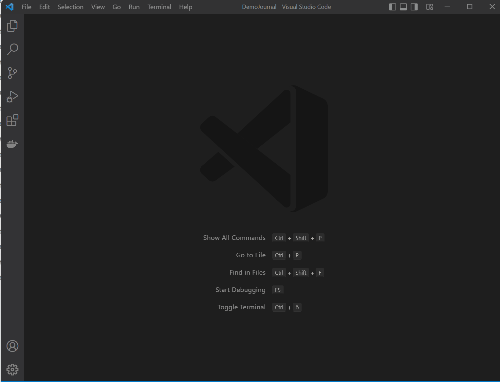

# Code Actions

Code actions are a Visual Studio Code feature (and basically every serious other IDE) to quickly run a commands from within the text. For now, the journal extension has code extension active for tasks. When you place your mouse cursor on a line with a task (any line starting with `- []` or `-[x]`), a yellow balloon will appear. You can trigger the selection of code actions by selecting the balloon or using the shortcut `CTRL+.` 

The following actions are supported for now
* Complete a task (marks the task and adds the completion time). A task with open [sub-tasks](./tasks.md#sub-tasks) also offers to complete them together with it.
* Reopen a task
* Migrate a task to today (when current entry is from another day). It will modify the task to  `[>]` (inspired by bullet journaling) and append the new date. Its open sub-tasks go along.
* Migrate a task to tomorrow
* Migrate a task to the next working day (if tomorrow is in the weekend)
* **Set Identifier**: gives a task its [key](./scopes.md#tasks-of-a-scope), e.g. `#acme:12`
* In the [plan of a scope](./scopes.md#plans), "Plan for today / tomorrow / the next working day" pulls the item into that day and marks it in progress (`[/]`); an item in progress can only be completed.

---

→ [Commands](./commands.md) · [Settings](./settings.md)
