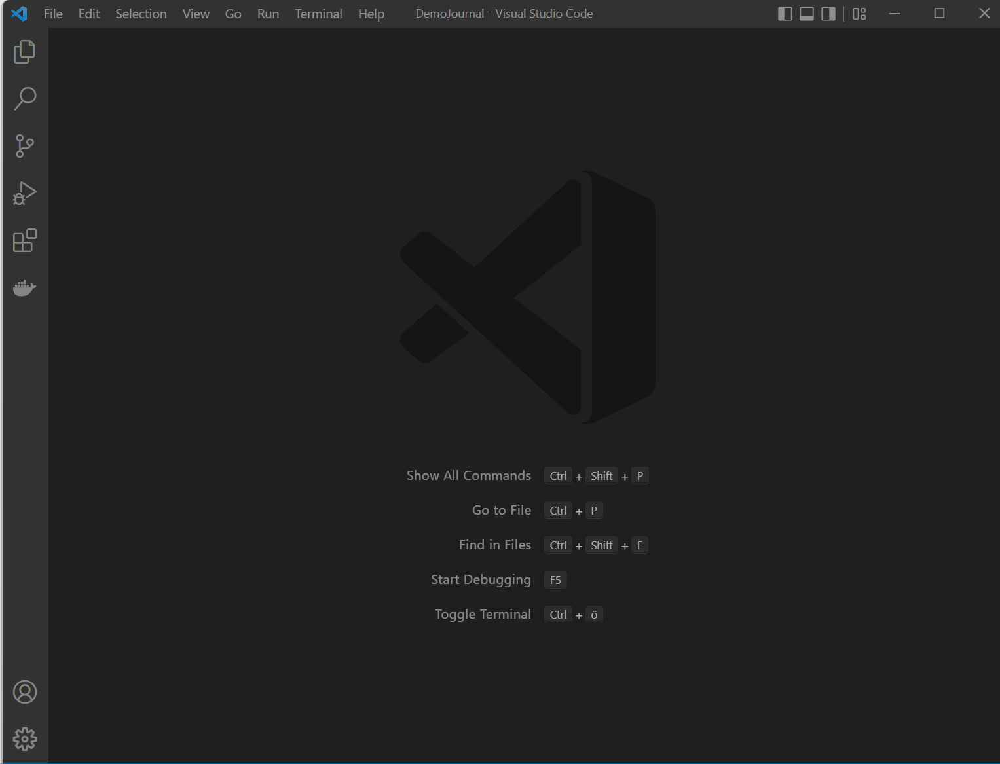

# Navigating to journal entries

A journal entry is created for every day. It collects the day's tasks, memos and any other content which you don't want to have in separate notes. I use it personally mostly for time tracking.  

A wide range of different inputs is supported, see [this page](./smartInput.md) for more details. 

## Day, week and month

The first line of an entry has links to the pages around it (CodeLens):

* In a **daily entry**: `Week 43` opens the weekly entry of its week, `October 2026` opens the calendar at that month.
* In a **weekly entry**: its seven days (`Mo 19` … `Su 25`) and its month (two months if the week spans them). A day marked with `+` has no entry yet; the click creates it.

The **Journal Calendar** (**Journal: Open Calendar**) opens beside the editor and shows a month:

* The week number in front of each week opens the weekly entry; a day opens its daily entry. Both are created if missing.
* Each day shows its open and all tasks (`⚠ 2/3`, or `✓ 0/2` when all are done) and its notes, and is marked while tasks are open. Days without an entry are dimmed, today is framed.
* `‹` and `›` go to the month before and after, **Today** back to today's month.
* The calendar follows the editor: when you open an entry of another month, it shows that month.

**Journal: Open Week** opens the weekly entry of the entry you are in (or of today). `Ctrl+J ,` and `Ctrl+J .` step to the previous and next entry, see [Commands](./commands.md).

