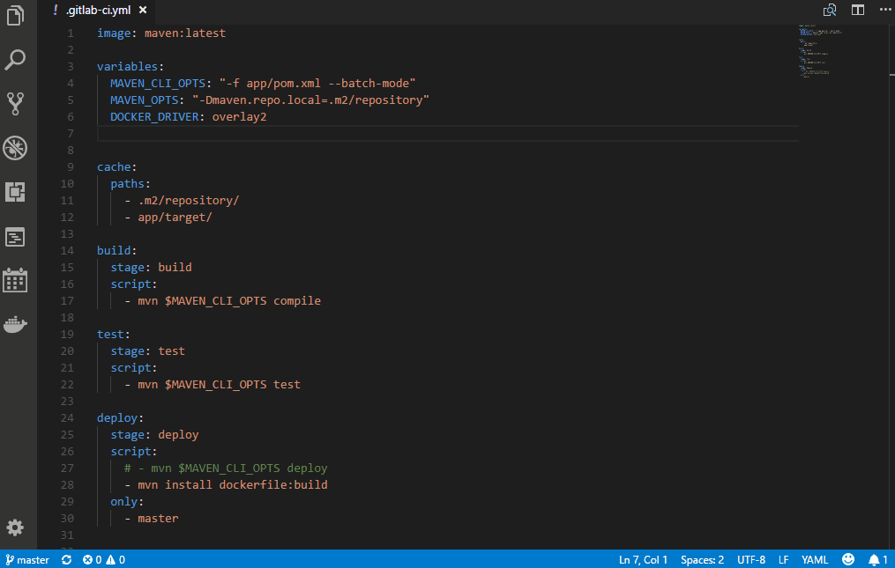

# Working with notes



Notes are single markdown files linked to the today's journal entry. `journal:note` (in the command palette using the shortcut `Ctrl+Shift+P`) opens a dialog to enter the title of a new page for notes. The title is also the filename (stored typically as subfolder in the journal structure, e.g. folder ´25´ in folder ´10´ if today is 10/25).  Local links are automatically added to the current day's journal entry.

You can also use the journal's smart input to create a note. Press `Ctrl+Shift+J`, pick "Select/Create a note" and enter the title. To create a note for another day or week, type `note` and the date before the title in the smart input, e.g. `note mon Security Code Review` or `note w23 Planning`: the note is linked from that day's or week's entry instead of today's (see [Smart Input](./smartInput.md)).

Notes are automatically linked in the according journal entry: when you create a note, the entry of its day links it. When you open an entry, it also links the notes whose path names that day, e.g. files you copied into the day's notes folder (`2026/10/09/`) or files named with the date (`notes/2026-10-09_Minutes.md` with the notes pattern `${d:YYYY-MM-DD}_${input}.${ext}`). If your notes pattern has no day in it (a flat or monthly notes folder, or a [scope](./scopes.md) folder), a note belongs to the day its file was created, so notes saved there by other tools are linked too. Editing an older note never links it from today's entry: notes are assigned by their path or creation date, not by their modification date.

Not every file in a notes folder is a note: hidden files (`.DS_Store`), temporary files (`~$Minutes.docx`) and subfolders are never linked. To skip further files, e.g. images or exports, list file name patterns in `journal.notes.ignore` (`*` matches any characters, `?` one character, case is ignored):

```json
"journal.notes.ignore": ["*.png", "*.jpg", "*.tmp"]
```

## Support for Scopes
You can add a scope tag to the note title to store the note in a project-specific location.

If you enter something like "#projectA Workshop Minutes" as title, the new document is stored in the scope `projectA` (by default the folder `scopes/projectA`) instead of the date folders, and today's entry links to it. Create scopes with **Journal: Create Scope**, see [Scopes](./scopes.md).

## Wiki links

Link entries and notes with wiki links instead of markdown links:

| Link | Opens |
|---|---|
| `[[2026-10-20]]` | the entry of that day, wherever it is (also in an earlier [layout](./settings.md#changing-the-layout)) |
| `[[2026-w43]]` | the weekly entry of that week |
| `[[Workshop Notes]]` | the note with that title, in any scope (case, `_` and spaces don't matter) |
| `[[#projA Workshop Notes]]` | the note with that title in the scope `projA` |
| `[[20/Minutes]]` | the note "Minutes" in the folder `20`, if several notes are called "Minutes" |
| `[[2026-10-20\|yesterday's entry]]` | the same, shown as "yesterday's entry" |

* **Ctrl+click** (Cmd+click on macOS) opens the target. A day without an entry gets one, like **Today**; a note title that no note has creates the note (in its scope with `#scope`).
* **Type `[[`** to get the entries, weekly entries and notes suggested, newest entries first. For a note whose title is not unique, the suggestion adds the folders needed to tell it apart. A relative date such as `[[yesterday`, `[[+1` or `[[next wednesday` is suggested as the day it names (`[[2026-10-19]]`): links in files name the day, a relative date would change its meaning tomorrow.
* The **markdown preview** shows wiki links as links.
* A note linked with a wiki link is not linked a second time when the entry links the notes of its day, also by the MCP server.

Wiki links are not standard markdown: other markdown viewers, such as GitHub, show them as text.

## Images and files
Paste an image (`Ctrl+V`) or drop a file into an entry or note, and VS Code copies it next to the document and inserts a link; the Markdown preview (`Ctrl+Shift+V`) shows images. No setup is needed for this.

To keep these files in an `assets` folder instead, named after the document, add a rule for your journal folder to VS Code's setting `markdown.copyFiles.destination` in your user settings (`settings.json`):

```json
"markdown.copyFiles.destination": {
    "Users/me/Journal/**/*.md": "assets/${documentBaseName}-${fileName}"
}
```

An image pasted into the entry of 18 October 2026 is then stored as `2026/10/assets/2026-10-18-image.png`. Other Markdown files are not affected. Files in `assets` are not linked as notes of the day.

* The key is the path of your journal folder (`journal.base`) **without the leading slash**, followed by `/**/*.md`. A key starting with `/` would be read relative to the workspace folder. On Windows, use forward slashes and a lower case drive letter: `c:/Users/me/Journal/**/*.md`.
* Put characters such as `(`, `)`, `[` or `{` in folder names in brackets: `Users/me/My [(]Journal[)]/**/*.md`.
* If your scopes or scope folders (`journal.scopeRoot`) are outside of the journal folder, add a rule for each of them.
* If you open the journal folder itself as workspace, `"/**/*.md"` in the workspace settings is enough.

See the [VS Code documentation](https://code.visualstudio.com/docs/languages/markdown#_inserting-images-and-links-to-files) for further variables such as `${documentWorkspaceFolder}` or `${isoTime}`.

---

→ [Commands](./commands.md) · [Settings](./settings.md)
