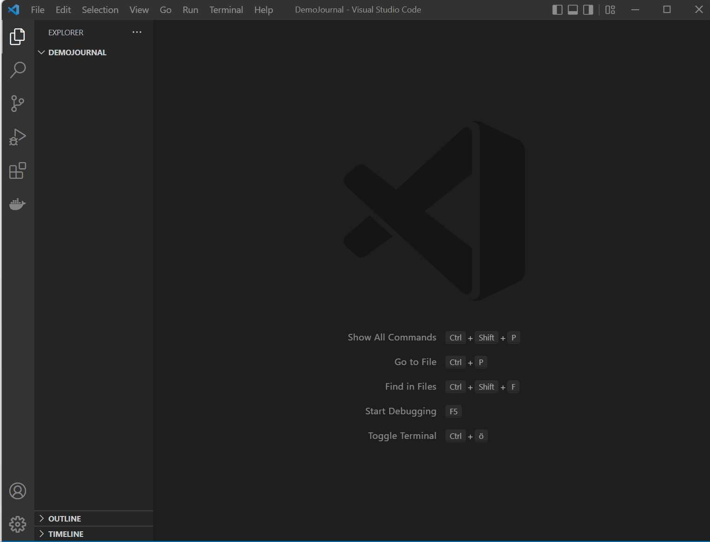

# Scopes

Scopes are the projects of your journal, e.g. a client or a topic. A scope has a slug, such as `acme`, and a folder. Its slug is a tag, `#acme`:

* a note titled `#acme Kickoff` is stored in the folder of the scope, and today's journal entry links to it
* a task `#acme call the client` stays in your journal and gets a key of the scope: `#acme:12 call the client`

| Written | Meaning |
|---|---|
| `#acme` | the scope tag: a scope `acme` exists |
| `#acme:12` | the key of task 12 in the scope `acme`: the scope tag with an identifier valid in the scope |
| `:12` | a key in the default scope (only as a word of its own: `10:30` is no key) |
| `#urgent` | a tag; no scope has that name |

In journal files, scope tags are shown in their own color, also inside keys and in the text of tasks (theme color `journal.scopeTag`, see [Settings](./settings.md)). Ctrl+click on a scope tag (Cmd+click on macOS), or **Journal: Show Scope**, shows the scope: for now the journal search for its tag, which lists the entries and notes of the scope.

## Creating a scope

Run **Journal: Create Scope** from the command palette.

1. Enter the slug: lowercase letters, digits and `-`, starting with a letter (`acme`, `web-shop`, `ai360`). `default` is taken.
1. Confirm or change the folder. It is proposed below the scope root (`journal.scopeRoot`, default `${base}/scopes`) and must be inside the journal.

The extension creates the folder, with an empty `.gitkeep` so that git keeps it. A folder elsewhere in the journal (e.g. `clients/acme`) is also written to `journal.scopes`, so that the scope is found. Below the scope root, every folder is a scope, so a folder there must be named like the slug.

You can also create folders below the scope root yourself, e.g. with your file manager: each of them is a scope.

If lines of your journal already have the tag `#acme`, the command tells you how many: they name the new scope now.

## Notes in a scope

1. Press `Ctrl+Shift+J` and pick "Select/Create a note", or run **Journal: New Journal Note**.
2. Enter the scope tag and the title, e.g. `#acme Sprint Daily Notes`. Further tags (e.g. `#draft`) are written into the note.

The picker shows "Create new note in scope "acme" …" when the scope has been detected. The note is created as `scopes/acme/Sprint_Daily_Notes.md` from the `note` template, and a link (`files` template, by default `- NOTE: [Sprint Daily Notes](../../scopes/acme/Sprint_Daily_Notes.md)` below `## Notes`) is added to today's journal entry.

The notes of a scope lie flat in its folder. Notes in a scope folder are linked from the entry of the day they were created, also when another tool created them. Editing them later does not add further links.

A wiki link names the scope the same way: `[[#acme Sprint Daily Notes]]`.



## Tasks of a scope

Tasks stay in your daily and weekly entries: the journal is where you work. A task that names a scope gets the next key of the scope:

* typed in the smart input: `task #acme call the client` is written as `- [ ] #acme:12 call the client`
* written by hand: place the cursor on the task and select the code action **Set Identifier**. A task without a scope gets a key of the default scope: `- [ ] :7 call the bank`.

Keys count per scope, over the whole journal: the next key is one above the highest one in your entries and notes. A task with a key keeps it.

Search for `#acme` in the smart input to find the entries and notes of the scope.

## Plans

The plan of a scope is every task with a key in the files of its folder, e.g. a roadmap `Plan.md`, structured by headings and sub-tasks:

```markdown
## Phase 1: Discovery
- [ ] #acme:5 interviews
  - [ ] #acme:6 interview guide
  - [x] #acme:7 invite participants (done: 2026-11-10 09:00) [[2026-11-10]]
- [ ] report
```

The work happens in the journal:

1. Place the cursor on an item of the plan and select **Plan for today** (or tomorrow, or the next working day). The item and its open sub-items get keys (if they have none), are copied into the day with a link to the plan, `- [ ] #acme:5 interviews [[Plan]]`, and are marked in progress in the plan: `- [/] #acme:5 interviews`.
1. Work on it in the journal. Moving it on to another day keeps it in progress.
1. Complete it in the journal: its plan item is completed, with the time and a link to the day, `(done: 2026-11-13 10:00) [[2026-11-13]]`. Reopening it in the journal puts the plan item back in progress.

The plan follows the journal when an entry is saved and right after the complete and reopen actions; a plan file that changes is saved, unless it has unsaved changes. A plan item can also be completed in the plan itself, e.g. for work done outside of the journal.

In a plan file, an item with sub-items shows how many are done, e.g. `2/3` after its line (not written into the file). Two plan items with the same key are marked as an error. Ctrl+click on the identifier of a key in the journal (`:5` in `#acme:5`) opens its plan item.

## Configuring scopes

`journal.scopes` (an array) lists the scopes whose folder is not directly below the scope root, and the templates of scopes. **Journal: Create Scope** writes the entries for you.

```json
"journal.scopes": [
    {
        "name": "acme",
        "base": "${base}/clients/acme"
    },
    {
        "name": "meetings",
        "templates": [
            { "name": "note", "template": "# ${input}\n\n${tags}\n\n## Participants\n\n## Minutes\n" },
            { "name": "task", "template": "- [ ] ${input}", "after": "## Meetings" }
        ]
    }
]
```

* `name` — the slug of the scope.
* `base` — the folder of the scope, inside the journal; relative paths and `${base}` are relative to `journal.base`. Without it, the folder is `<scopeRoot>/<name>`.
* `templates` — templates of the scope (same format as `journal.templates`): `note` for its notes, `task` and `memo` for tasks and memos that name the scope.

`patterns` and `patternHistory` of an entry are no longer read: the notes of a scope lie flat in its folder.

Links to notes of a scope always go into the journal entry of the day.

## MCP server

The [MCP server](../mcp-server/README.md) resolves scopes the same way. `create_scope` takes a slug, `add_task` takes a `scope` (or `#acme` in the text) and gives the task its key, and the scope tools list, create, read and extend the notes of a scope. `get_scope_plan` returns the plan with keys, states and progress; adding a plan item's key to a day with `add_task` puts it in progress, and completing or reopening it with `update_task` updates the plan, as in the editor.

---

→ [Commands](./commands.md) · [Settings](./settings.md)
