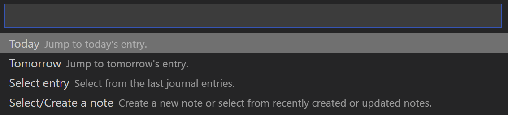
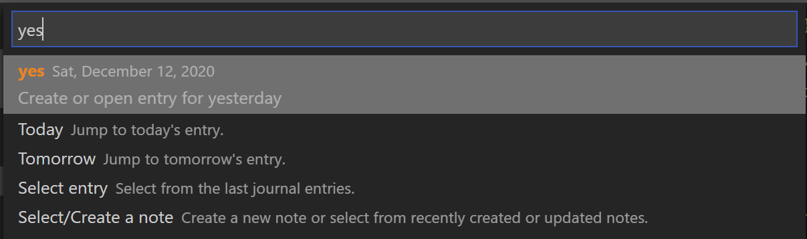
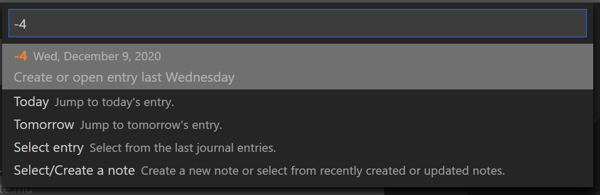
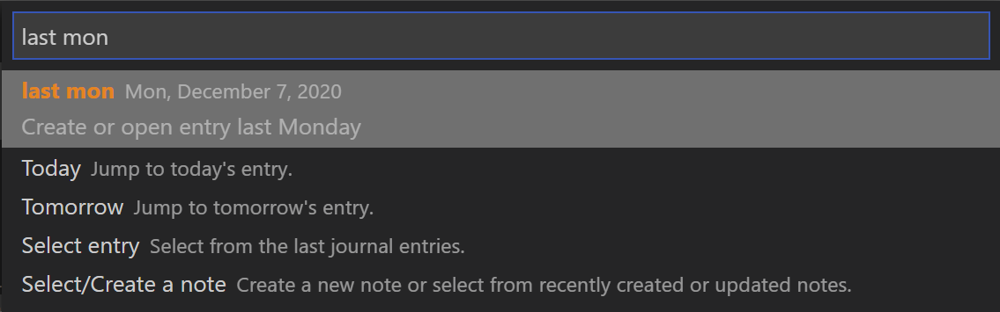
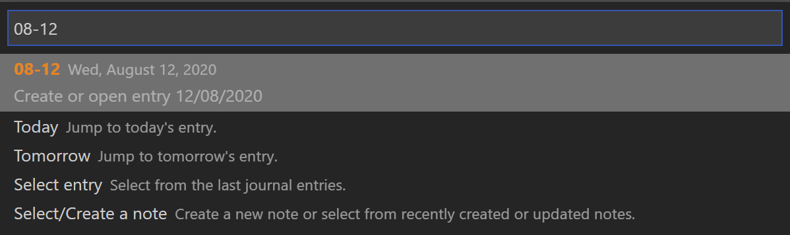

# Examples how to use the smart input

Using the shortcut ```CTRL+SHIFT+J``` to opens the following dialog. 



From there you can either start typing away (see below for options) or select one of the following options: 

* *Today* selects or creates the journal entry of the today 
* *Tomorrow* selects or creates the journal entry of the tomorrow 
* *Select entry* opens a list of existing journal entries. The icon in front of an entry shows its tasks: a yellow warning while tasks are open, a green check when all are done, the clock if it has none. Below the entry you see the number of open tasks and the notes it links, e.g. `2 open tasks · 3 notes`. Moved tasks and links to other entries are not counted
* *Select/Create a note* opens a list of existing notes for selection. You are still able to create a new note by simply typing the note title. 

Both lists show the newest files first, by the day a file belongs to (see [Search the journal](#search-the-journal) for how that day is found), not by when it was last edited.
* *Search journal* searches entries, weekly entries and notes (see [Search the journal](#search-the-journal))

This guide including its examples assume english as your display language. If you changed the setting **Display Language** in Visual Studio Code, you probably see other messages. Supported languages for this extension are: 

* English (en)
* German (de)
* French (fr)
* Spanish (es)
* Italian (it)
* Portuguese (pt)
* Dutch (nl)
* Russian (ru)
* Chinese (Pinyin) (zh)
* Japanese (Romaji) (ja)
* Arabic (ar)


## Supported input options
The help text in the dialog will tell you, what action will be performed after analyzing the input. 

The following actions are possible: 
* Pick a specific journal entry by entering a shortcut, offset, weekday or specific date
* Open a week's entry (last, this, and next, or a numbered calendar week)
* Add a memo to today's page or to a page of a specific date
* Add a task to today's page or to a page of a specific date


### Pick journal entry by shortcut


Supported shortcuts are
 
 * `today, tod` for today's journal entry
 * `tomorrow, tom` for tomorrow's journal entry
 * `yesterday, yes` for yesterday's journal entry

 Each entry will also create the entry if it doesn't exist yet. 


### Pick journal entry by offset


* ``` 0 ``` to select today's entry. Or simply press enter. 
* ``` -1 ``` to select yesterday's entry
* ``` +1 ``` to select tomorrows entry
* ``` -2423 ``` to select a day far in the past

### Pick journal entry  by day of week


 Supported values are `monday, mon, tuesday, tue, wednesday, wed, thursday, thu, friday, fri, saturday, sat, sunday, sun` 

You can use the modifiers `last` and `next` to go either into the past or future. The last is the default, if you simply enter `mon`, the journal page for next monday will be opened. 

* `next wednesday` for journal entry of next wednesday
* `last wednesday` for journal entry of last wednesday

### Pick weekly entry 
Supported values are `week w13` 

You can use the modifiers `last` and `next` to go either into the past or future. The last is the default, if you simply enter `w` or `week`, the weekly page for the current week is opened

* `next week` for weekly entry of next calendar week
* `last week` for weekly entry of last calendar week
* `w1` for weekly entry of the first week of this year
* `w99` works as well (well, why not)


### Pick journal entry by date


You can jump to a specific date using the following options

* `25`: By only enterying a number, the journal entry for  the day of the current month is selected
* `10-25` selects Oct 25 of the current year  
* `2015-25-10` for Oct 25 in 2015

The syntax follows the ISO Standard `YYYY-MM--DD`


### Add a memo to today's page
`This is an important thing to remember`

Just enter any text. If no modifiers (a date modifier for picking a journal entry) or the flag "task" are included, the new text will added as memo to the journal entry of the current day. 


### Add a memo to any journal entry 
`+1 I have to remember this` 

Enter any of the modifiers (offset, date or weekday) _before_ entering any text. The new memo will then be added to the journal page of the selected date. 

### Add a task to today's page
`todo Order christmas presents`

If you add flags like `todo` or `task` _before_ any text, it will be added as task to page of the journal entry of the current day. 

Other examples

* `task fri Submit proposal` if you have a deadline this friday
* `task 10-30 Buy myself a present for my birthday` .. since why not 
* `task next wed Remember the milk` .. because the one in the fridge is spoiled by then

### Create a note for a day or a week
`note mon Security Code Review`

The flag `note` creates a note instead (the title is everything after the date) and links it from the entry of that day, here Monday's, instead of today's. With a week (`note w23 Planning`, `note next week Planning`) the note is linked from the weekly entry, and no daily entry is created. Without a date, the note is for today, or for the current week if `journal.entryGranularity` is `weekly`.

## Search the journal
*Search journal* in the smart input, or the command **Journal: Search Journal** (`journal.search`), finds entries, weekly entries and notes in all journal folders: the journal base, the folders of your scopes and the scope root. It works in every VS Code window, whatever workspace is open.

* Type one or more words: a file is listed if every word appears in its title or its text. Upper and lower case and accents don't matter (`muller` finds `Müller`), the beginning of a word is enough (`plan` finds `planning`), and words of five letters or more may contain a typo (`agnda` finds `agenda`). A hit in the text shows the matching line, and choosing the hit opens the file at that line.
* Type `#scope` (the name of a scope) to search only in that scope, e.g. `#projectA review`. A `#tag` that is not a scope is searched as a word.
* Results are sorted by relevance: words in the title count more than words in the text, and rare words more than common ones. Recent files rank higher than old ones with a similar match. The date of a file is the day it belongs to: the day of a daily entry, the first day of a weekly entry's week, the day folder of a note. Files from before you changed `journal.patterns` count too: the search also knows the default patterns and any date in the path (`2019/03/14`, `2019-03-14`). A note in a month folder (`2025/03/notes/…`) belongs to the day it was created if that lies in the month, else to the first of the month; files without any date in their path belong to the day they were created (for a copied or cloned journal, the day of the copy). Editing an old note does not make it recent.
* Without words, the list shows the newest entries and notes.

The search reads the journal folders each time it opens, so files created or changed in other windows or by other tools are found too; only new and changed files are read again. A few seconds after VS Code starts, the extension reads the journal in the background, so the first search does not have to wait. In remote sessions (SSH, WSL, containers) it doesn't: there the first search reads the journal, which can take a moment on a large journal; matches by title appear right away.

To open the search with its own key, bind `journal.search` (see [Commands](./commands.md#how-to-rebind)). The settings `journal.search.*` turn the search off, choose when the index is built, limit the search to titles, and set how much recent files are preferred (see [Settings](./settings.md#search)).

---

→ [Commands](./commands.md) · [Settings](./settings.md)

