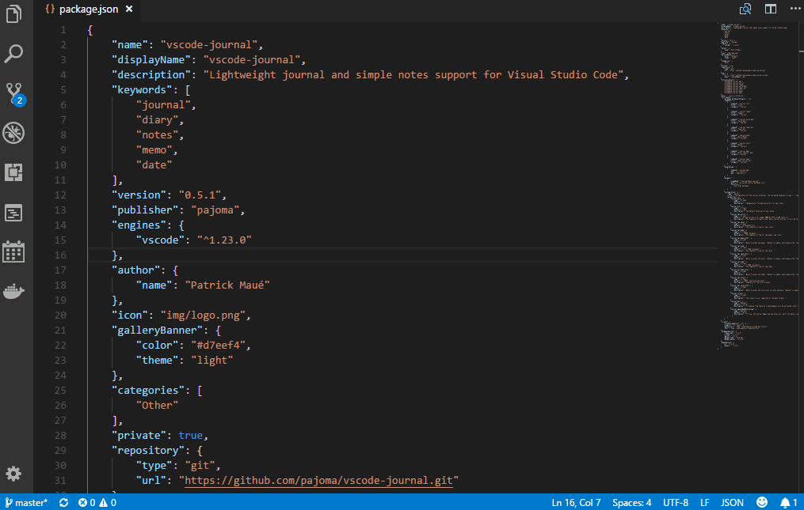

# Working with tasks



Tasks are modelled as checkpoints in your journal entries, e.g. 

```markdown
# Sunday, 2018/06/03

- [ ] Task: Fill out my taxes
- [x] Task: Finish the exercise 
```

You can enter tasks either manually or by the journal smart input (using `Ctrl+Shift+J`). The following examples work for the smart input: 

* `task Fill out my taxes` adds a task to today's entry
* `task 06-24 Call my mom` adds a task for entry of June 24th
* `task +1 Call my mom` adds a task for entry for tomorrow
* `task tom Call my mom` adds a task for entry for tomorrow
* `task next friday Call my mom` adds a task for entry for next friday

## Sub-tasks

Indent tasks below a task to make them its sub-tasks, e.g. the steps of a ticket:

```markdown
- [ ] Ticket XX-1155 update items in db
  - [ ] update records
  - [x] verify new records (done: 2026-10-19 10:00)
  - [ ] create new requests
```

Every line below a task that is indented deeper belongs to it: sub-tasks, their own sub-tasks and any text you write under them.

* **Complete:** on a task with open sub-tasks, the code actions offer *Complete this task* and *Complete this task and its 2 open sub-tasks*. Sub-tasks that are already done keep their completion time.
* **Plan for another day:** the task and its open sub-tasks are marked `[>]` and inserted in the target entry, the sub-tasks indented below the task. Done sub-tasks stay where they were done.

The [MCP server](./mcp.md) handles sub-tasks the same way: it asks before completing open sub-tasks, and moving or migrating a task takes its open sub-tasks along.

---

→ [Commands](./commands.md) · [Settings](./settings.md)
